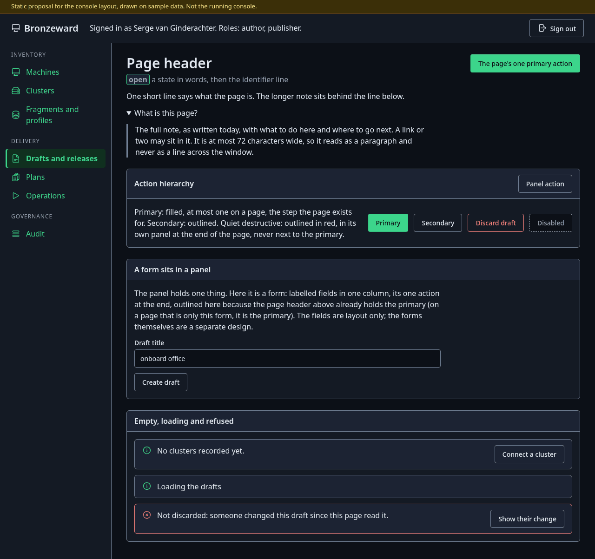
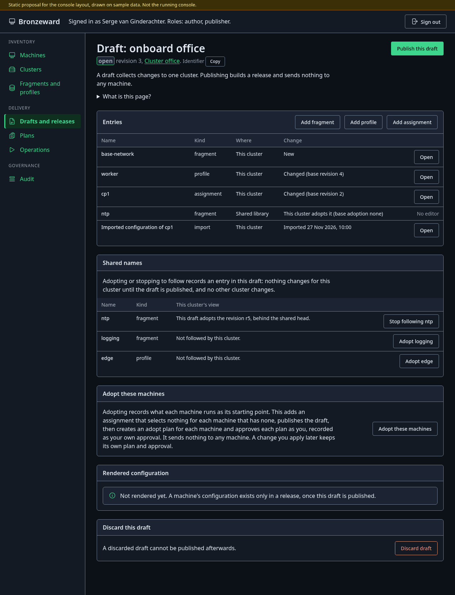
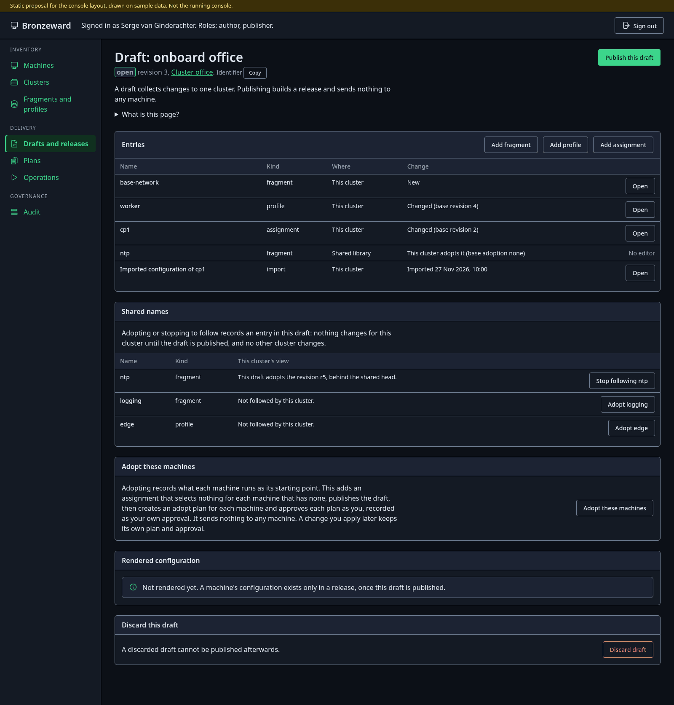
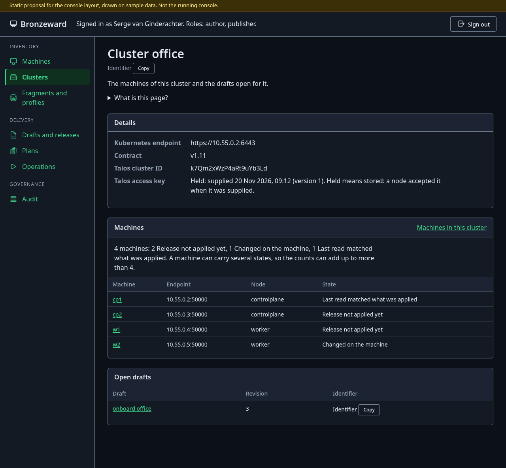
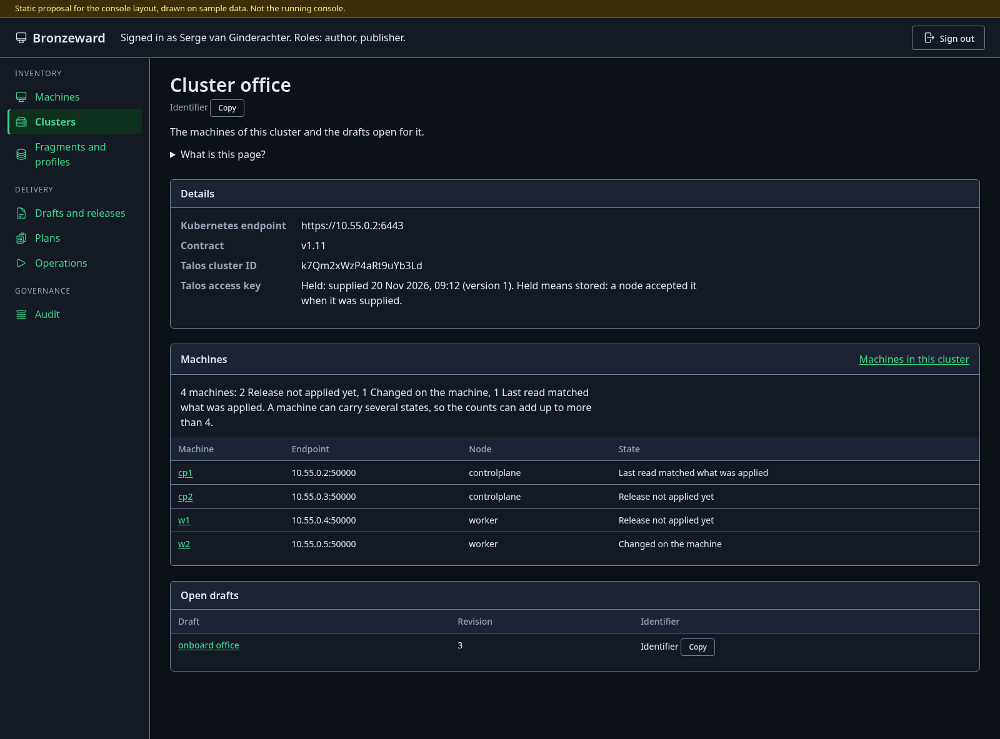
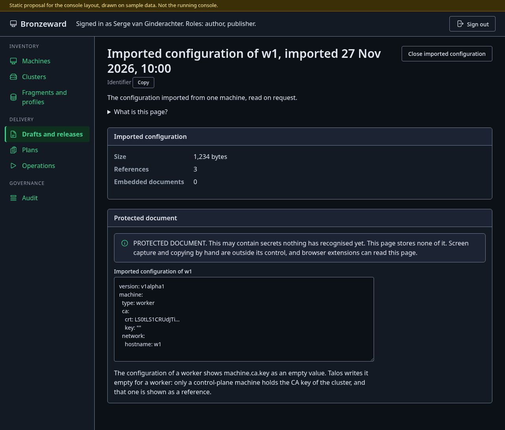

# Console layout: page building blocks, starting with the draft page

| | |
| --- | --- |
| Date | 27 November 2026 |
| Status | **Accepted.** The owner accepted the delivery report of this design on 28 November 2026 (00:38 CET). The five recommendations of section 6 are taken as decided, each reversible: the notes behind "What is this page?", Discard draft outlined red alone in its panel at the end, Publish this draft as the one filled button with Adopt these machines outlined, the present table padding, and the entry editor in its own panel under Entries. The draft page is built to it ([ginsys/bronzeward#1255](https://github.com/ginsys/bronzeward/issues/1255)), and so are group A of section 4, the cluster page, the Clusters and Machines lists and the operation page ([ginsys/bronzeward#1257](https://github.com/ginsys/bronzeward/issues/1257)), and group B, the six lists ([ginsys/bronzeward#1259](https://github.com/ginsys/bronzeward/issues/1259)), and the plans and delivery part of group C, the plan page, the apply page, the drift page and the operation page's details and Attempts ([ginsys/bronzeward#1261](https://github.com/ginsys/bronzeward/issues/1261)), and the machine page, the release page and the rendered review ([ginsys/bronzeward#1263](https://github.com/ginsys/bronzeward/issues/1263), first part); the other pages follow in the order of section 4 |
| Work item | [Design the console's page layout, ginsys/bronzeward#1235](https://github.com/ginsys/bronzeward/issues/1235) |
| Reads | `origin/main` at `29c5765f`, on 27 November 2026 |
| Author | A design session, an agent. The renders are static proposals on sample data, not the running console |

## 1. The problem

The owner tried the console by hand on 27 November 2026 and said: "layout needs to be better, UX, look, needs a professional designer". He named five things: the page is not well aligned; buttons are big and text is small; there are no titles; there are no boxes that make a layout; and the configuration is a box of JSON text (that last one is [ginsys/bronzeward#1234](https://github.com/ginsys/bronzeward/issues/1234), a later item, and this document does not touch it). He liked the tables in bordered panels on the cluster page, and found the text at its top "too much text lines, hard to read".

This document did not see his screenshots. It reads the pages in the source and checks each complaint there.

- **The draft page has no panels.** Its parts are headings followed by loose content (`web/src/drafts.tsx`, the page function `DraftItem`). The entries are a bullet list: a fragment, profile or assignment is a button, an adoption is plain text, and an imported configuration is a link plus a second button, "Show imported configuration".
- **Every action looks the same.** The `Action` component (`web/src/shell.tsx`) draws a bare button, and no code in `web/src` sets a button variant. So each button is the same filled green, Oat's default: Add fragment, Adopt these machines and Discard draft all look alike. Publish this draft is not a button at all but a link, between two buttons.
- **Add fragment, Add profile and Add assignment are below Shared names**, because that section sits between the entries and the Add row.
- **Text runs the full width.** Only the page column has a limit (90 rem). A paragraph has none. The draft page stacks a five-sentence note (three notes joined in one paragraph), the Shared names note and a status line, so a reader meets several long lines before the first control.
- **The cluster page is mostly text at its top.** A two-sentence note, an identifier line, a sentence with the endpoint, contract and cluster ID, a link paragraph and the Talos access sentences come before the first panel (`ClusterItem` in `web/src/machines.tsx`). The panels below it are the ones he liked.
- **An imported configuration repeats its notice.** It is a button, then a "PROTECTED DOCUMENT" notice, shown again for every imported machine a draft holds, above a 24-row text area (`web/src/claim.tsx`).

What the console already has is more than the page uses. `web/src/app.css` defines a bordered panel with a header band, the table style he liked, a wrapping toolbar row, the alert box, a detail grid and a spacing scale (`--s1` to `--s6`). The panel is used in three places: the machines and drafts panels of the cluster page, and one section of the operation page. The rest of the console uses headings only. So most of the work is using what exists, plus a small number of additions.

## 2. The building blocks

The console is a desktop console, designed at 1280 and 1600 px, dark only, with Oat 1.1.0 as the base and the client's own stylesheet over it ([client contracts §10.4](../spec/client-contracts.md#104-styling-and-the-content-policy), [ginsys/bronzeward#973](https://github.com/ginsys/bronzeward/issues/973)). Each block below says what it is, where it applies and which of three marks it carries on that base:

- **Existing**: already in `app.css` or in the Oat files the client bundles.
- **Small addition**: a few rules in `app.css`, shown in full in section 2.9.
- **Not buildable**: the base or the content policy does not allow it; section 2.10.

| Block | Rule in one line | Mark |
| --- | --- | --- |
| Page header | Title and state on the left, the page's one primary action on the right | Small addition |
| Panel | A bordered box with a titled band; it holds one thing | Existing; actions in the band are a small addition |
| Action hierarchy | One filled button per page; secondary is outlined; destructive is outlined red, alone at the end | Oat classes exist; per-variant hover is a small addition |
| Reading width and notes | Text is at most 72 characters wide; one line says what the page is, the rest is behind "What is this page?" | Small addition; the disclosure is a native `details` element |
| Table | The cluster page's table, with the name in the first column and the action in the last | Existing; three small rules |
| Spacing and alignment | One scale; panels are 1.5 rem apart; everything aligns to the panel edge | Existing |
| Empty and loading | A one-line alert box with its action beside it | Existing |



*Static proposal at 1280 px: the blocks on sample data.*

### 2.1 Page header

The title is the page's name, never an identifier. Under it one line gives the state in words and the cluster, then the quiet identifier line with Copy, as the page has today ([ginsys/bronzeward#1236](https://github.com/ginsys/bronzeward/issues/1236) keeps this). The right side holds the page's one primary action, if it has one. The header's own Sign out becomes an outlined button, so the page's single filled button is the page's own.

### 2.2 Panel

A panel holds one thing: a table, a list, a detail grid, a message, or a form. Its band has the title on the left and, where the panel has actions, the actions on the right. The actions of a panel sit in its band, so "Add fragment" is under, and belongs to, Entries. A panel with a form holds fields in one column and the form's one action at the end ([ginsys/bronzeward#1234](https://github.com/ginsys/bronzeward/issues/1234) will put its fields there; nothing here designs them). A section that reads lazily, as Shared names does today, keeps doing so: its panel shows the title and a "Show shared names" button in the band, and the table appears when it is pressed.

### 2.3 Action hierarchy

- **Primary** is Oat's filled button, unchanged. There is at most one on a page. It is the step the page exists for: Publish this draft on a draft page.
- **Secondary** is Oat's `.outline` button. Add fragment, Open, Adopt this name, Copy, Sign out and Adopt these machines are secondary.
- **Destructive** is the same outline in the danger colour, in a panel of its own at the end of the page with one sentence above one button. It is never next to the primary, and never the default. This is the one confirmation pattern the owner already decided; the proposal changes only how it looks.
- **Disabled** keeps the dashed border and the full contrast the client already has.

A control whose role is missing is still disabled with its reason beside it, as today.

### 2.4 Reading width and notes

Every titled page shows a note today, and the client contracts say so ([§10.4 item 6](../spec/client-contracts.md#104-styling-and-the-content-policy)): what the page is, what to do, where to go next. The proposal keeps every word of the note and changes where it sits. One line stays visible under the title; its wording is new and short, and each page's build writes it. The whole note is behind a "What is this page?" disclosure. Running text is at most 72 characters wide on every page, so a note reads as a paragraph and never as a line across the window.

This moves a rule the contract states, so it is question 1 in section 6. If the answer is no, the page keeps one short note, still limited to 72 characters.

### 2.5 Table

The table is the one he liked: header band, row rules, 0.5 rem and 0.75 rem cell padding. Three small changes: the first column is a row header in the foreground colour (it is a muted colour today), the last row has no extra rule, and an action column is right-aligned with a hidden header word so a screen reader still hears a column. A table that can be wider than its panel scrolls by itself and is reachable by keyboard, as today.

### 2.6 Spacing and alignment

The scale does not change. A panel is separated from the next by `--s5` (1.5 rem), its band and body use `--s3` and `--s4`, and every panel, table, alert and line of text starts at the left edge of the page column. The renders show the result at 1280 and 1600 px. The column is at most 90 rem; at 1600 px it fills the window beside the navigation, so the panels are wider and the text is not (72 characters).

### 2.7 Empty and loading states

The alert box is the one state message: an icon and one sentence, with its action beside it ("No clusters recorded yet." with Connect a cluster). Loading is the same box with the existing words. A refusal is the same box with the danger border and its recovery action. This is existing CSS and existing words; the proposal only fixes that a panel shows the box inside its body, under its band.

### 2.8 The rules every block keeps

These are the rules of [§10.4](../spec/client-contracts.md#104-styling-and-the-content-policy), and the screen-reader work in [ginsys/bronzeward#447](https://github.com/ginsys/bronzeward/issues/447) must not find a block that breaks them. The numbers below are computed from the colours in `app.css` and the proposal, with the formula of WCAG 2. They are not measured in a browser. The same formula reproduces the six numbers `app.css` quotes (text 15.46, secondary text 7.43, link 10.16, button text on the filled button 10.61, danger 7.46, border 4.75).

- **Keyboard.** The Tab order is the markup order, and no rule reorders what is drawn: title, the primary action, the note, then the panels in order, each band's actions before its table. This moves the draft page's Publish this draft from the end of the page to the first control after the title, which is a change of order the build must state and test. The header and navigation keep their order, as [§10.4 item 6](../spec/client-contracts.md#104-styling-and-the-content-policy) requires. "What is this page?" is a native `details` element: Enter and Space open it, and it needs no script. Nothing is fixed or sticky (WCAG 2.4.11, §10.4 item 5).
- **Focus.** The 3 px ring in the ring colour stays on every control, including outlined ones. A target is at least 24 px: the smallest control here is the Copy button, about 28 px high.
- **Contrast of text.** Outlined button text on a panel body 14.2, on a panel band 12.7 and on its hover 12.7. Danger text on a panel body 6.8, on a band 6.2 and on its hover 6.5. Secondary text on a body 6.8 and on a band 6.1. All are above 4.5.
- **Contrast of borders.** An outlined button's border on a body 4.35 and on a band 3.9. The danger border on a body 6.8. All are above 3.
- **Not colour alone.** A destructive action says "Discard draft" in words; a state is a word, as in the badges today. Danger is a second cue, never the only one.
- **Disabled.** A disabled outlined button keeps a dashed border and 7.4 contrast, as a disabled filled button does today.
- **Reflow.** Below 68 rem the navigation stacks and a panel's band wraps its actions under its title. No design effort goes below that.

### 2.9 The small additions

All of this is unlayered CSS in `app.css`, like the rest of the file, and uses only the spacing scale and opaque hex colours.

```css
/* Reading width */
main p, main dd { max-width: 72ch; }
main .alert p, main .panel-head p { max-width: none; }

/* Page header, note */
.page-head { display: flex; flex-wrap: wrap; align-items: flex-start; gap: var(--s3) var(--s5); margin: 0 0 var(--s3); }
.page-head .titles { flex: 1 1 24rem; min-width: 0; }
.page-head h2 { margin: 0 0 var(--s1); }
.page-head .state { margin: 0; color: var(--muted-foreground); }
.actions { display: flex; flex-wrap: wrap; align-items: center; gap: var(--s3); }
.actions button, .actions > span { margin: 0; }
.lede { margin: 0 0 var(--s2); }
details.about { margin: 0 0 var(--s5); }
details.about > summary { width: fit-content; min-height: 24px; padding: var(--s1) 0; cursor: pointer; }
details.about > p { margin: var(--s2) 0 0; padding-inline-start: var(--s4); border-inline-start: 3px solid var(--border); }

/* Panel band with actions, table and detail grid flush inside the panel */
.panel-head { display: flex; flex-wrap: wrap; align-items: center; justify-content: space-between; gap: var(--s2) var(--s4); padding: var(--s3) var(--s4); background-color: var(--muted); border-bottom: 1px solid var(--border); border-radius: 0.375rem 0.375rem 0 0; }
.panel-head h3 { margin: 0; padding: 0; border: 0; background: none; font-size: 1rem; }
.panel > .panel-head { margin: 0; }
.panel > .panel-head + * { margin-block-start: var(--s4); }
.panel > .panel-head + .scroll, .panel > .panel-head + dl { margin-block-start: 0; }
.panel > .scroll { margin-inline: 0; border: 0; border-radius: 0 0 0.375rem 0.375rem; }
.panel > dl { margin: 0; padding: var(--s4); border: 0; border-radius: 0 0 0.375rem 0.375rem; background-color: transparent; }
.panel > p { margin-block: 0 var(--s3); }
.panel > .panel-head + p { margin-block-start: var(--s4); }
.panel .row { display: flex; flex-wrap: wrap; align-items: center; gap: var(--s3) var(--s5); }
.panel .row p { margin: 0; flex: 1 1 24rem; }
.panel .row .actions { margin-inline-start: auto; }

/* Action hierarchy: Oat's .outline and data-variant="danger" already draw the fill, text and border. Only the hover colour is named,
   because app.css forces one green on every button. No background is set here, so Oat's hover fill (it reads --_hov) still applies,
   and a disabled button keeps app.css's own dashed rule. */
button.outline { --_hov: #1c2333; }
button.outline[data-variant="danger"] { --_hov: #2b1a20; }

/* Table */
tbody th[scope="row"] { color: var(--foreground); }
tbody tr:last-child th { border-bottom: 0; }
td.action, th.action { text-align: right; white-space: nowrap; }
td.action button { margin: 0; }
.muted { color: var(--muted-foreground); }
```

In the components this is one `Panel` and one `PageHead` wrapper, a `variant` choice on `Action` (primary, secondary, destructive), and a `Note` that draws the line and the disclosure from the sentences the page already passes to `PageNote`. The page's e2e selectors and test ids stay where they are; a build step moves them only where the markup requires.

### 2.10 What the base cannot do

- **A bar that stays in view.** A sticky page header or action bar would cover a focused control (2.4.11), so the primary action scrolls with the page.
- **Oat's accordion for the disclosure.** Its file draws the marker as a `data:` image, which the content policy refuses (`img-src 'self'`). The native `details` element with the browser's own marker does the same job and is already used on the apply page.
- **Other Oat components.** Only six Oat files are bundled: base, theme, form, button, table and animations. Cards, tabs, badges and dialogs are not in the bundle. Adding one is its own decision, and the proposal does not need one. The panel, the alert and the badge are the client's own classes.
- **Two columns at 1280 px.** With the 15 rem navigation, a second column beside a table leaves both too narrow. An entry's editor opens below the entries, not beside them.

## 3. The pages redesigned

### 3.1 The draft page



*Static proposal at 1280 px, sample data. The notes, headings and button words are the console's. The one-line summary under the title, the "No editor" cell and the discard sentence are sample wording written for the render.*



*Static proposal at 1600 px.*

Reading it from the top:

1. **Header.** "Draft: onboard office", the state and the cluster in one line, the identifier line, and Publish this draft as the one filled button. The five-sentence note becomes one visible line (in the render: "A draft collects changes to one cluster. Publishing builds a release and sends nothing to any machine.") with the full note behind "What is this page?".
2. **Entries.** One panel, one table: name, kind, where (this cluster or the shared library), what changes, and one action per row. Add fragment, Add profile and Add assignment are in the panel's band, under the heading they belong to. An adoption has no editor, so its row says so. The imported configuration is one row with one Open button that goes to its page, so a row no longer carries both a link and a second button for the same thing.
3. **Shared names.** Its own panel with its sentence and a table: name, kind, this cluster's view, and Adopt or Stop following. Closed, the panel is its title and a "Show shared names" button, and nothing is read until it is pressed.
4. **Adopt these machines.** Its own panel. Its sentence stays whole, because it says the action also publishes. The button is outlined: the page's one filled button stays Publish this draft. See question 3.
5. **Rendered configuration.** A panel that holds today's "Not rendered yet" line. It is where a later render of the compiled result ([ginsys/bronzeward#336](https://github.com/ginsys/bronzeward/issues/336), deferred) would go. Nothing is decided about it here.
6. **Discard this draft.** The last panel: one sentence and one outlined red button.

When an entry is opened, its editor is a panel directly under Entries, so a person does not scroll past three other panels to find it. The editor's content is [ginsys/bronzeward#1234](https://github.com/ginsys/bronzeward/issues/1234)'s to design.

### 3.2 The cluster page



*Static proposal at 1280 px.*



*Static proposal at 1600 px.*

The top is a title, the identifier line and one line of text. The note is behind "What is this page?". The endpoint, contract, cluster ID and the Talos access sentence move into a Details panel as a two-column grid, so the page has three panels (Details, Machines, Open drafts) and no loose paragraph. The machines table, the counts sentence and the drafts table keep their words. The link "Machines in this cluster" moves into the Machines panel's band, where a person looks for it.

### 3.3 An imported configuration



*Static proposal at 1280 px. The text is a short sample, not a real configuration.*

The draft's entry for it is the single Open button of section 3.1, so the draft no longer shows the button that reads the text. The text is still read on request, as today: the image shows the page after that request. The protected-document notice shows once, as an alert inside the Protected document panel, above the text. The text area stays a read-only box, because how the configuration is shown is [ginsys/bronzeward#1234](https://github.com/ginsys/bronzeward/issues/1234)'s decision.

### 3.4 How the renders were made

They are standalone HTML pages, not the React components. The proposed page changes the markup (a table for entries, panels with bands), so the existing components cannot draw it. Each page is the real `app.css` and the six Oat 1.1.0 files in the order the client bundles them, plus the CSS of section 2.9, filled with sample data and the console's own sentences. A headless Chrome took the images at 1280 and 1600 px. So they show the look and the spacing, and they do not show the components' states: long names, a refused write, a loading list. The empty, loading and refused boxes are on the block sheet. The images are quantized to 64 colours to keep the pull request small. The yellow band at the top of each image marks it as a proposal.

## 4. The other pages, and the order to build them

The navigation has eight pages in three groups (Inventory, Delivery, Governance), and each has item pages under it. Counted in `web/src` at the head read, only `machines.tsx` and `operation.tsx` use the panel, and only `machines.tsx` uses the toolbar row. Grouped by how far each page is from the blocks:

| Group | Pages | Distance |
| --- | --- | --- |
| A. Near | Clusters and the cluster page, the Machines list, the operation page | The cluster page and the operation page have panels; the cluster page needs its top cut. The Clusters and Machines lists have a toolbar and a table in a plain wrapper, so they need a header and a panel. The rest is read page by page when its pull request is written |
| B. Lists | Drafts and releases, Plans, Operations, Imports, Fragments and profiles, Audit | A heading, a note, in most a bare filter row, and a table. Each needs a page header, a toolbar and a panel around its table |
| C. Item pages | A machine, a plan, a release and its review, a fragment or profile and its revisions, a dependency, an import and its configuration, a publication, an apply, a drift | Headings and paragraphs, no panel. Each needs a header and panels for its sections |
| D. The draft page | The draft page and the editors of its entries | The largest. Section 3.1 |
| E. Forms | Create draft, Start import, Plan new, Add machine, Connect a cluster, approval and scope decisions | One form in one panel with one action. These screens wait for [ginsys/bronzeward#1234](https://github.com/ginsys/bronzeward/issues/1234) only where they edit configuration |
| F. Recovery | The recovery console and its operation page | Last: it is used rarely and under stress, so it changes once the blocks are proven |

A build order in six small pull requests, one group at a time. Each says what it leaves unchanged, and each keeps the test ids and selectors the e2e cases use unless the markup forces a change.

1. **The blocks and the draft page.** `Panel`, `PageHead`, `Note`, the `Action` variants and the CSS of section 2.9, used on the draft page only. It updates the contract text of §10.4 for the note rule if question 1 is yes. It leaves every other page's markup as it is.
2. **Group A.** The cluster page, the Clusters and Machines lists, the operation page. It leaves the words and the machine page as they are. *Built* ([ginsys/bronzeward#1257](https://github.com/ginsys/bronzeward/issues/1257)): each page's visible line is the first sentence of its note, and the operation page's note, being one sentence, is drawn as it is with no disclosure; Add machine is the one filled button of the Machines list and Connect a cluster of the Clusters list, with the other actions outlined in the page header; the filters are the toolbar row at the top of the table's panel; the operation page gets the page header and the note line, and its details and Attempts are left for group C.
3. **Group B.** The six lists, with one shared list header and toolbar. It leaves what each filter does as it is. *Built* ([ginsys/bronzeward#1259](https://github.com/ginsys/bronzeward/issues/1259)): one `ListHead` (the page header and the note line, the first sentence of each page's note) over a panel per table with the filters as the toolbar row under its band; Create draft is the one filled button of Drafts and releases and Start import of Imports, both now in the page header ahead of the note's disclosure, and Show more is outlined where the page has its own filled button; Plans, Operations, Fragments and profiles and Audit have no action; the "Imports, of every machine." line stays between the two panels of Drafts and releases, where its note says it is; Fragments and profiles is five panels (Fragments, Profiles, Assignments, Dependencies, Dependency alerts).
4. **Group C, plans and delivery.** A plan, the publication, an apply, a drift. It leaves the approval and write behaviour alone. *Built* ([ginsys/bronzeward#1261](https://github.com/ginsys/bronzeward/issues/1261)): the publication page is the operation page, so its details and Attempts are now panels (its Timeline is left as it was). Each page has the page header and the note line (the first sentence of its note, the whole note behind "What is this page?"; the operation page's note is one sentence and stays plain). The plan page is Details (with "Operations of this plan" in its band), Evidence, Approval, Revoke approval and Cancel plan; Approve is the page's one filled button and stays under the sentence that says what it records, so it is in the Approval panel and not in the header. Revoke approval and Cancel plan are outlined red, each alone in its panel at the end. The apply page is Shared names (where the release moved one), the machines of the release and Plans to approve; "Back to the release" is in the header, Apply is the one filled button and Show apply is outlined, both after the machines in Tab order. The drift page is The change, Freeze, Adopt and Revert with no filled button: they are three equal ways to decide. The state alerts of a plan stay loose above its first panel, and the apply page's machines stay a list in their panel. The approval part of the plan page's note stays whole inside the Approval panel.
5. **Group C, the rest.** A machine, a release and its review, a fragment or profile, a revision, a dependency, an import. It leaves the protected-document behaviour alone. It is built in two pull requests ([ginsys/bronzeward#1263](https://github.com/ginsys/bronzeward/issues/1263)), the second after the first merges because both change `web/src/resources.tsx`. *Built, first part*: the machine page, the release page and the rendered review. Each has the page header and the note line (the first sentence of its note, the whole note behind "What is this page?"; the machine page's link to Create a draft is part of the whole note, so it is behind the disclosure). The machine page is Status (the machine's line, its status sentences, the link to the drift page and the next step), Details, Observations, Timeline, then Name this machine (or Rename machine) and Change endpoint, each form in its own panel with its submit button outlined; its four links on the machine (its plans, its operations, its imports, Import this machine) are outlined in the header, and the page has no filled button, because its next step depends on the machine's state. The release page has Apply this release to machines as its one filled button, in the header, then Details, the source revisions and the machines covered. The review page has Back to the release outlined in the header, then Details (with the hostname lines), the configuration, Provenance and Next step; Plan adopt or Plan apply stays its one filled button, under the sentence in the Next step panel that says why. *Not yet built*: a fragment, a profile and an assignment and their revisions, a dependency, an import and an imported configuration.
6. **Groups E and F.** The forms, then the recovery console.

Group D's editors follow [ginsys/bronzeward#1234](https://github.com/ginsys/bronzeward/issues/1234), in the order the owner set: this design, then that specification, then the editor builds into the panels defined here. The issues for these pull requests are filed after the owner accepts the design, not before.

## 5. What this does not decide

- **Forms for configuration**, and how an imported configuration is shown as parsed fields: [ginsys/bronzeward#1234](https://github.com/ginsys/bronzeward/issues/1234). A panel only has room for them.
- **Words.** The notes keep every word and only their place changes. The one-line summaries and a few cell labels in the renders are sample wording: the build writes the real line for each page with the page's own words. Whether a page needs less text is not part of this.
- **Screen-reader passes**: [ginsys/bronzeward#447](https://github.com/ginsys/bronzeward/issues/447). Section 2.8 states what each block keeps, so that work does not start from a worse base.
- **The rendered configuration of a draft and per-field provenance**: [ginsys/bronzeward#336](https://github.com/ginsys/bronzeward/issues/336), deferred. Section 3.1 leaves a panel for it.
- **Assisted proposals of fragments** ([ginsys/bronzeward#919](https://github.com/ginsys/bronzeward/issues/919)) and **the endpoint proposal of Connect a cluster** ([ginsys/bronzeward#1059](https://github.com/ginsys/bronzeward/issues/1059)): they land on pages listed above, and nothing is designed for them.
- **A light theme, phone widths, a new icon set, a new colour palette.** The dark theme and its colours stay. Only two colours are new, both opaque hex values used for hover: one for an outlined button, one for the danger outline.
- **Anything measured in a browser.** The contrast numbers are computed. The renders are static. Whether the blocks pass the browser cases of the client is a fact for the build pull requests, which run them.

## 6. Questions for the owner

*Decided on 28 November 2026 as recommended, each reversible (see the Status line). The draft page is built to these answers. The questions and their recommendations stay as asked.*

1. **Should the full page note move behind "What is this page?"** The page would show one line and a disclosure. *Recommendation: yes.* The notes are the longest text on each page and he found the cluster page's top hard to read. The note keeps every word and is one keystroke away. The cost is a contract change: §10.4 says every page shows its note, and a person who never opens the disclosure will not see the "where next" sentence. If no, the note stays visible, shortened to the 72-character width.
2. **How should Discard draft look?** *Recommendation: outlined red, alone in a panel at the end of the page.* It stops looking like Adopt these machines and does not shout. A filled red button would draw as much attention as the primary. The word on the button still says what it does, so the colour is never the only cue.
3. **Which button is the draft page's one filled button?** *Recommendation: Publish this draft, in the page header, with Adopt these machines outlined in its own panel.* Adopt these machines publishes too, and a draft that holds only imported machines may want it as the main step. The alternative is to fill Adopt these machines when the draft's entries are only imports, and to outline Publish then. That is a rule with a second case, so it is not recommended before a person has used the page.
4. **How dense should tables be?** *Recommendation: keep the present cell padding.* Rows are 38 to 56 px high at 1280 px, which keeps a 24 px target with room. A compact table would fit more rows but, for one page, can be switched later with one variable. If the machine list grows to many nodes, this is the first thing to revisit.
5. **Where does an entry's editor open?** *Recommendation: in its own panel directly under Entries.* Today it opens at the end of the page, below the Add row and the Shared names. Beside the entries it would be too narrow at 1280 px, as section 2.10 says. The editor's fields are for [ginsys/bronzeward#1234](https://github.com/ginsys/bronzeward/issues/1234).
